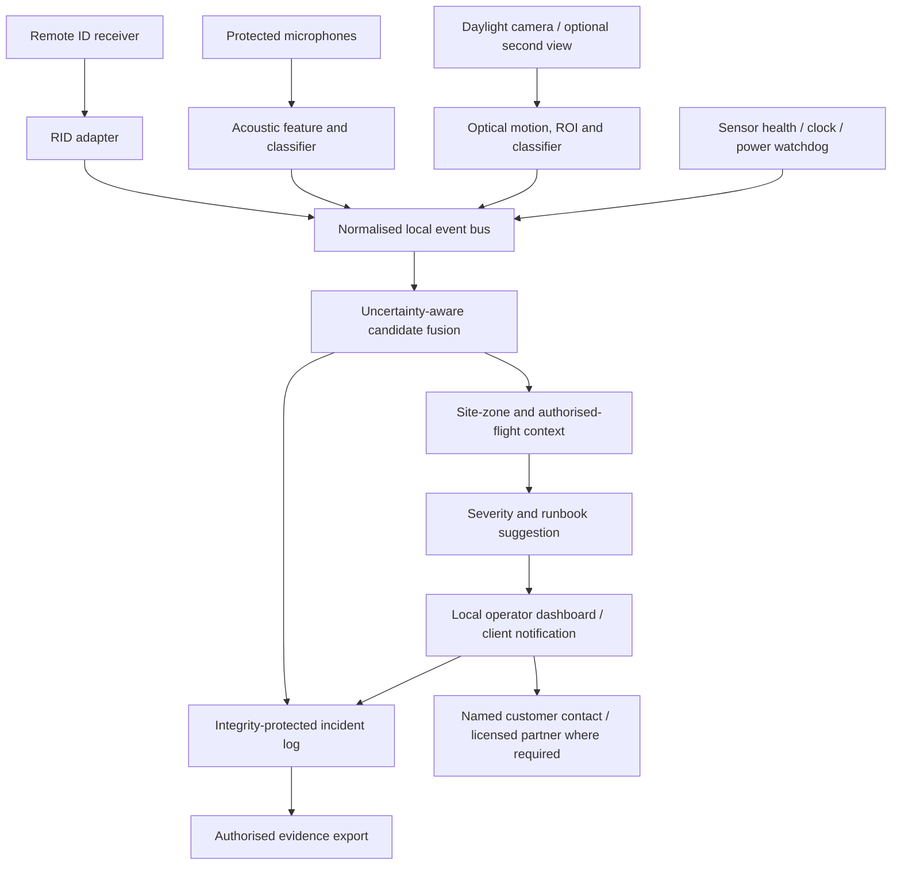

# Dronect
## Evidence-Aware Multimodal Aerial Security for R&D-Intensive Offices
### Technical Whitepaper — Reference Deployment for a Single Office Floor

**Version:** 0.3 (reference-design candidate)  
**Date:** 6 November 2026  
**Language:** English  
**Status:** Engineering design and validation protocol; **not** a completed proof of performance  
**Target deployment:** one exposed office floor in a Spanish R&D company  
**Prepared for:** Dronect / UJI Startup Bootcamp 2026

> **Evidence boundary.** This document combines (i) requirements and strategic decisions established by the Dronect team in the v0.2 Knowledge Pack; (ii) technical information from the cited public sources; and (iii) **explicit engineering assumptions** selected to make a testable reference design. There is **no measured Dronect field-performance dataset**, validated commercial bill of materials, client-site survey, signed legal opinion or purchased sensor package at the time of writing. Nothing here should be described as an achieved 99.9% drone-detection rate.

---

## Executive summary

Dronect is a proposed **Security-as-a-Service** offering—not merely cloud software—for organisations holding valuable intellectual property. Its service integrates a site-specific exposure assessment, leased and managed sensors, local detection and incident triage tooling, tailored runbooks, personnel enablement, evidence-aware reporting and lawful incident coordination. Its first paid pilot is envisaged in Spain, with the founders personally installing and operating the system without compensation during validation. The team proposes **€1,200 per quarter**, provisionally for two quarters, with a hardware-spend aspiration of **US$2,000 or less**. [I1]

This technical whitepaper converts the broad concept into a reproducible experiment for **one 600 m² office floor**. It proposes **one instrumented, outward-facing sector protecting a sensitive window bank**, rather than whole-floor, whole-building or 360° airspace protection. The concept combines three passive sensing paths: (1) broadcast Remote ID (RID), where available; (2) acoustic candidate detection; and (3) optical tracking of visible aerial objects. A local edge computer fuses these observations with contextual risk and sends explanations and proposed actions to designated customer personnel. No radio jamming, takeover, kinetic interception or autonomous enforcement is contemplated.

The RF-independent paths matter because a drone executing a stored flight plan may not transmit a useful control or video link; a noncooperative or modified aircraft may also fail to broadcast RID. Neither microphones nor cameras can guarantee detection in poor geometry, adverse weather, acoustic clutter or insufficient target pixel size. The **99.9% per-flight detection ambition is a long-term, conditional research target**, not a pilot SLA. The minimum credible MVP result is a **demonstrated, instrumented observation of at least one authorised flight with RID data unavailable to the detector, plus quantified false alarms and documented blind spots**. [S1]

A research-grade component allowance of **€1,610** and external pilot cash expenses of **€390** produce an illustrative six-month cash requirement of **€2,000**, before founder labour, general overhead, regulatory/insurance expenses beyond the assumptions, or exceptional legal services. Two paid quarters yield €2,400 before VAT and collection risk: a **€400 illustrative contribution**, not a sustainable enterprise gross margin. The US-dollar hardware cap must be checked separately against actual landed quotes and exchange rates. [I1]

**Engineering recommendation:** proceed with a **limited daytime, fair-weather, line-of-sight proof of concept** only if (a) a valid site and lawful flight-test pathway are obtained, (b) legal classification and privacy impact are reviewed, (c) the camera can resolve small targets in the defined zone, and (d) external cash costs remain within a recorded budget. No installation should be sold as near-perfect office-floor coverage until controlled field results support that statement.

---

## 1. Scope, principles and terminology

### 1.1 System boundary

**In scope for this reference MVP:**

- Risk assessment of one sensitive window bank and its adjacent exterior observation sector.
- A small sensor node made from third-party components, installed by founders with building-owner approval.
- Passive RID reception; trial acoustic sensing; one primary daylight optical view and an optional second view.
- Local ingest, candidate detection, basic multimodal correlation, event audit trail and alert dashboard.
- Human-validated security classification and two or three client-approved runbooks.
- A supervised, legally authorised test programme, followed by a bounded pilot period.
- Cost accounting of purchased components and external expenses, with separate tracking of unpaid founder hours.

**Out of scope:** whole-building omnidirectional protection; guaranteed nighttime/all-weather performance; centimetre-grade drone positioning; guaranteed operator identification; radar procurement; detection of all airframes at any range; automatic police escalation; continuous outsourced alarm centre; interference or active counter-UAS measures; general trade-secret litigation or patent prosecution; automated blinds/actuators unless independently scoped and approved.

### 1.2 Important distinctions

| Term | Meaning in this paper | What it does **not** establish |
|---|---|---|
| **Observation** | A physical sensor records a potentially relevant signal or object | That it is a drone |
| **Detection** | Algorithm identifies a candidate event at a stated threshold | That the candidate is correctly classified |
| **Classification** | Candidate assigned to a class, e.g. drone / bird / unknown | Pilot identity or hostile intent |
| **Tracking** | Consecutive observations joined over time | Accurate range or three-dimensional position |
| **Identification** | Supported attribute, e.g. decoded RID ID or recognisable model | Legal identity of an adversary |
| **Security relevance** | Track intersects a defined asset/time/behaviour rule | Industrial espionage has happened |
| **Evidence package** | Authenticity-aware record of what Dronect observed | Automatic legal admissibility or proof of wrongdoing |
| **RF-silent** | No useful RF emission available to Dronect during the monitored interval | No physical sound, silhouette or thermal signature |

These distinctions follow the multi-stage detection, tracking and identification framework described by the European Commission Joint Research Centre (JRC). [S1]

---

## 2. Reference building and protected-zone model

### 2.1 Fictional but representative site

The following is a **design assumption, not a measured customer site**:

| Parameter | Reference assumption | Engineering implication |
|---|---|---|
| Floor dimensions | 30 m × 20 m | 600 m² net geometric reference footprint; internal usable space may differ |
| Floor position | Fourth occupied floor | Example camera mounting height approximately 15 m above local ground |
| Exposed façade | One 30 m south-facing glazed frontage | Principal threat pathway is observation through windows; no assumption of rooftop surveillance |
| Sensitive assets | A 10 m-wide bank of windows overlooking an R&D work area | Focus first sensor view on a small high-value asset, not all façade surfaces |
| Outside environment | Typical urban/business campus with traffic, birds, HVAC and adjacent buildings | Acoustic clutter and optical occlusion must be logged |
| Legal right to mount | One customer-approved, outward-facing fixing point by the façade | If unavailable, the planned geometry and cost model are invalid |
| Utilities | Nearby power and customer-approved network/VLAN | Avoid standalone 4G cloud dependence; network work still needs approval |
| First test envelope | Daylight, fair weather, visible target, supervised tests | No night/fog/rain guarantee |

**Why asset-first?** An airframe does not need to fly directly over the building to see a prototype or an unprotected window; conversely, protecting all 600 m² of office interiors would be a misleading unit of detection coverage. The correct object of design is a **three-dimensional set of plausible lines of sight to sensitive assets**. A drone with an optical zoom lens may collect imagery from outside the pilot's detection range. A successful sensor pilot cannot substitute for window films, curtains, careful prototype placement or procedural protection.

### 2.2 Primary monitored sector: test definition

Place an approved optical sensor near the centre of the protected window bank, facing outward and slightly upward. The **proposed evaluation sector** is an *intersection*, not a guarantee:

- **Azimuth:** nominally **±25°** around the façade-normal orientation.
- **Slant distance from camera:** **10–40 m** to the target.
- **Elevation:** approximately **−5° to +20°** from camera horizon, subject to actual sensor tilt and obstructions.
- **Airframe used for baseline calculations:** visually exposed width **0.30 m** (an example, not a universal drone dimension).
- **Conditions:** useful daylight, adequate visibility, no intervening façade/trees/roof or glare obstruction, and no requirement for acoustic detection at maximum range.
- **Required verification:** camera sight-line survey and actual test tracks, not only a plan-view estimate.

A camera with a roughly 66° horizontal and 52° vertical field of view could geometrically include this narrow sector when correctly pointed, but the critical question is **whether the drone is resolvable and recognised at each distance and angle**. Geometric inclusion is *not* equivalent to effective detection. [S2]

**Unmonitored or unvalidated regions** include the remaining exterior frontage, opposite façades, the space directly overhead or behind the camera, interior courtyards, obstructions, substantial distances beyond the measured range, and low-light/poor-weather conditions. These must be displayed on a customer-facing coverage map.

### 2.3 Text-only site sketch (not to scale)

```text
                              SOUTH / EXTERIOR

                authorised test flight trajectories
                       10 m ......... 40 m
                     \       test sector       /
                      \    ±25° azimuth       /
                       \                    /
                        \                  /
                [outward-mounted optical/acoustic/RID node]
        ┌─────────────────────────────────────────────────┐
        │   glazed south façade — 30 m frontage           │
        │          [10 m R&D sensitive window bank]        │
        │                                                 │
        │                  Office floor                   │
        │                   30 × 20 m                     │
        │                                                 │
        └─────────────────────────────────────────────────┘
                     NORTH / building interior

        Note: schematic corridor, NOT 360° radar coverage.
```

---

## 3. Threat model

### 3.1 Relevant cases

| Case | Typical signal expectation | Required candidate path | MVP posture |
|---|---|---|---|
| A. Authorised consumer drone broadcasting RID | RID plus possible visual/acoustic observations | RID, cross-check with permitted flight list | Core control case |
| B. Ordinary drone whose RID is absent or incompatible with receiver | Possible non-RID RF, visual, acoustic | Optical and/or acoustic | Test explicitly |
| C. Autonomous craft following a stored route and not furnishing a usable RF link | No useful command/video RF; legal RID obligations may still apply | Optical and/or acoustic | Core research objective, **not proven** |
| D. Small quiet drone at distance / behind obstruction | Weak sound and tiny/occluded image | May be undetectable | Residual risk and no guarantee |
| E. Bird/aircraft/traffic/noisy HVAC | Confusing video/audio without matching RID | False-positive rejection, human review | Negative-data requirement |
| F. Long-range optical surveillance beyond the sector | No useful detection signal within the designed zone | Outside scope | Physical/operational secrecy controls |
| G. Sensor tamper, network outage, clock skew | Missing or corrupt observations | Health monitors and fail-visible state | Mandatory failure handling |

**Adversary assumption:** deliberately noncooperative surveillance is possible, but a detected drone is **not** presumed malicious. Dronect should record *what is observed and why it is relevant*, leaving intent and legal conclusions to qualified assessment. The RF protocol explanations supplied in `gemini_convo.txt` are useful background, but that text contains **neither a priced parts list nor empirical detection results**. [I2]

### 3.2 Safety and lawfulness

No test should disable RID where it is legally required, deceive air-traffic services, breach geo-zones, or introduce harmful radio interference. To assess RF independence without unlawful operation, the data-fusion system can **mask RID inputs during an otherwise authorised flight**, while measuring optical/acoustic detections physically; this shall be labelled **RF-input-absent simulation**, not a fully RF-silent aircraft. Actual non-emitting test configurations require prior confirmation of their legality and any applicable authorisations. EU flight rules and Spanish geographic restrictions apply. [S5][S6]

---

## 4. Sensor architecture and procurement choices

### 4.1 Three required sensing channels

**Channel R — Remote ID reception.** A low-cost receiver development board and compatible Wi-Fi/Bluetooth radio inspect supported broadcast RID variants. The protocol stack should use a maintained OpenDroneID implementation where suitable. The team must validate supported BLE legacy/extended advertisements, Wi-Fi beacon and NAN modes, chipset/firmware limitations, scanning duty cycle, timestamp precision, antenna placement and licence for commercial use. An RID **transmitter** is not a receiver. Remote ID may be absent, forged, malformed or outside supported reception conditions; it does not prove good faith. [S7]

**Channel A — acoustic observations.** Use a 4-element or otherwise calibrated microphone configuration, weather/wind shielding and an edge feature extractor to identify rotary-propeller-like sound patterns. Acoustic processing should default to **features without permanent voice/audio retention**, with a privacy-law review of any temporary waveform buffer. A commercial voice-conferencing microphone array can serve as a laboratory integration prototype; it should **not** be represented as a proven 40 m drone sensor. For example, the ReSpeaker XVF3800's advertised range refers to **voice capture up to 5 m**, not aerial-object detection. [S8]

**Channel O — daylight optical observations.** One primary fixed-view RGB camera, with optional second overlapping view if budget and installation support it. A Raspberry Pi AI Camera is a reasonable R&D baseline because its Sony IMX500 supports local neural-network inference and can be integrated with Pi software. It is **not a weatherproof or drone-trained detector** by default. Its official product brief specifies 4056 × 3040 still resolution, 2028 × 1520 at 30 fps, an approximately 66.3° horizontal field of view, 640 × 640 maximum input tensor for the on-sensor inference model, and **no infrared sensitivity**. The sensor must be housed safely and within environmental specifications; enclosure windows, condensation, heat and reflections can reduce usable performance. [S2][S3]

### 4.2 Why optical resolution is a first-order risk

For a small approximately flat target near the optical axis, an indicative apparent image width is:

\[
\text{target pixels} \approx \frac{W_{px}\,w_{target}}{2d\tan(\theta_h/2)}
\]

where `W_px` is image width, `w_target` is apparent target width in metres, `d` is slant distance and `θ_h` is horizontal field of view. This is a **pinhole-model approximation** (not an empirical detector-performance prediction). Using **0.30 m**, **66.3°** and the camera modes above:

| Distance | 2028 px capture | 4056 px capture | Direct full-frame resize to 640 px |
|---:|---:|---:|---:|
| 15 m | ~31 px | ~62 px | ~9.8 px |
| 25 m | ~19 px | ~37 px | ~5.9 px |
| 40 m | ~12 px | ~23 px | ~3.7 px |
| 50 m | ~9 px | ~19 px | ~2.9 px |
| 60 m | ~8 px | ~16 px | ~2.4 px |

**Implication:** a drone may be present in the field of view yet poorly represented at the detector input size, particularly near or beyond 40 m. A wide-angle camera expands geometric coverage while reducing pixels per target. Options to evaluate—not presume successful—are (i) small-object-aware detector training, (ii) motion-track candidates on higher-resolution input, (iii) region-of-interest tiling and cropped inference, (iv) a narrower field-of-view lens/camera for the specific window bank, and (v) more cameras with overlapping sightlines. On-device IMX500 tiling and the CPU's ability to process multiple feeds require benchmarking; the 640 × 640 tensor limit must not be misrepresented as 640 × 640 camera resolution.

### 4.3 Radar and additional RF fingerprinting

A purpose-built drone radar can help with noncooperative targets under conditions where RF receivers are ineffective, but is not included in the price cap. **Generic automotive mmWave development boards cannot be treated as a drop-in C-UAS radar.** Their advertised target-detection distance or motion sensitivity is not validation for small aerial targets in clutter. Likewise, optional SDR/RF fingerprinting helps only when a usable signal is emitted. Leave adapters open for future radar, thermal cameras and professional RF receivers, but do not feature their benefits as MVP results. [S1]

### 4.4 Candidate components and acceptance criteria

| Block | Procurement class | Desired interface / acceptance | Disqualifier or test risk |
|---|---|---|---|
| RID | Wi-Fi/BLE development receiver + external/appropriate antenna | Raw/decoded messages, timestamped events, verified supported bearer modes | Incomplete protocol support; transmitter wrongly purchased |
| Acoustic | 4-channel microphone interface or calibrated array | Digital PCM/features, channel alignment, realistic outdoor placement | Voice-only beamforming treated as drone classification; wind noise |
| Optical | 1 primary AI Camera or comparable controllable camera | Raw/full-res access, custom model or ROI, adjustable mounting and focus | Only person/vehicle detector, no small-object testing |
| Optional second view | Additional camera module or RTSP/ONVIF camera | Overlap and stable synchronous timestamps | Extra power, glare, model latency, enclosure cost |
| Edge | Raspberry Pi 5-class 4 GB machine or comparable low-power computer | Two feeds if used, encryption, local DB, reliable watchdog | Thermal throttling, insufficient compute, storage wear |
| Enclosure/power | Rated housing, sealed optical window, protected cables, power/UPS | Documented electrical safety, weatherproofing, isolation | Unsafe façade fitting; overheating; condensation |
| Networking | Wired customer-approved isolated network | TLS/HTTPS, clock sync, outage queue, role-restricted access | Needs an insecure inbound public service |

**Procurement gate:** do not buy the whole list before testing a single camera/receiver/microphone on a table and obtaining at least a simple legal/siting agreement. Preferred components above are **implementation candidates**, not committed SKUs or quoted commercial hardware.

---

## 5. Software and edge topology

### 5.1 Logical architecture



### 5.2 Components and deployment boundaries

1. **Device adapters.** A process per modality emits structured observations with timestamps, device ID, software version, raw-data pointer (if lawful) and an uncertainty flag. Do not coerce every signal into an invented geographic coordinate.
2. **Local transport.** A bounded in-memory queue or lightweight message broker, with durable event persistence for confirmed candidates. Detect and record message loss/queue overrun.
3. **Model inference.** Optical motion proposals on high-resolution frames, detector inference on cropped regions, temporally consistent tracklets; separate audio feature extraction and scoring. Initial software can be Python/OpenCV plus a supported IMX500 runtime, subject to measured CPU and latency budgets.
4. **Context engine.** Configured window bank, operating times, prior authorised flights, exclusion/masking zones, sensor availability, and asset exposure score. Never treat non-reception of RID as proof of hostility.
5. **Local dashboard.** Candidate state, evidence confidence, timestamp, approximate bearing where actually known, sensor-health state and actionable customer-approved runbook. Role-restricted access.
6. **Notification adapter.** Customer-approved e-mail/secure webhook/other transport; message should include event ID and brief assessment without exposing raw confidential images by default. Retry and fail-visible behaviour required.
7. **Management plane.** Optional EU-hosted service for version control, support and aggregated availability only if contract/data-protection review permits. **No remote cloud dependency for the initial sensor fusion loop**; however, external notification cannot survive all network outages without a local alternative.

### 5.3 Illustrative event contract (draft)

```json
{
  "schema_version": "0.3-draft",
  "event_id": "evt-20261106-0001",
  "site_id": "DEMO-OFFICE-001",
  "sector_id": "SOUTH-WINDOWS-01",
  "observed_utc": "2026-11-06T09:15:08.420Z",
  "node_clock_status": "synced",
  "device_health": {"rid": "available", "acoustic": "available", "optical": "available"},
  "observations": [
    {"modality": "optical", "candidate": "unidentified_airborne_object", "score": 0.78, "view_id": "CAM-01"},
    {"modality": "acoustic", "candidate": "rotor_like_pattern", "score": 0.62, "sensor_id": "MIC-01"}
  ],
  "remote_id": {"received_for_track": false, "interpretation": "no_matching_RID_observation"},
  "association": {"status": "provisional", "method": "time_and_bearing", "geolocation": null},
  "risk_context": {"asset": "R_AND_D_WINDOW_BANK", "authorised_flight_status": "unknown"},
  "state": "candidate_drone",
  "action": "customer_visual_review",
  "evidence": [{"type": "masked_still", "sha256": "<hash-of-actual-file>"}],
  "model_versions": {"optical": "unvalidated-model-id", "acoustic": "unvalidated-model-id"},
  "review_status": "pending_human_review"
}
```

The above values are **illustrative synthetic data**, not an incident. Model scores are not calibrated probabilities unless validation establishes calibration. The absence of a matched RID message means only **not observed by the configured receiver**.

---

## 6. Detection, tracking and fusion policy

### 6.1 Pipeline

- **Candidate generation:** accept an independent optical or acoustic candidate; a RID message can also generate an event. Never require `RID AND camera` to fire, as it would suppress RF-silent cases.
- **Temporal association:** merge optical tracklets when trajectories and time windows are compatible; where acoustic direction-of-arrival is unreliable, associate by time only with low confidence.
- **Evidence assessment:** maintain separate confidence scores for each modality, measured input quality, and device health. A simple deterministic rules engine is preferable to opaque model confidence multiplication during the MVP.
- **Contextual impact:** evaluate whether the plausible track is near a monitored window, at relevant time, and not recorded as an authorised flight. This is *risk scoring*, not criminal attribution.
- **Human escalation:** require a trained client reviewer or properly authorised professional for decisions that could affect people, security operations or law-enforcement communications.

### 6.2 State machine

`raw_observation → candidate → corroborated_candidate (when possible) → security_relevant → human_reviewed → resolved / escalated`

Allow `candidate → security_relevant` through a single high-quality optical path if another modality is silent; attach a **single-modality** warning. Similarly, allow RID-only events in the awareness dashboard without declaring hostile intent.

### 6.3 Avoiding inflated confidence

- Do not multiply scores from highly correlated models or consecutive video frames as if they were independent sensors.
- Do not infer 3D range from a single fixed camera without an independently justified geometric solution.
- Do not classify two related optical images as two independent proofs.
- Record undecidable cases and negative evidence. Report unknown rates rather than hiding them.
- Treat an unresponsive sensor as a **degraded-coverage alert**, not as a clean zero-event interval.
- Separate **detection latency**, **customer notification latency**, and **customer action latency**. Fast detection is not protection if blinds cannot be closed before a sensitive image is collected.

---

## 7. Physical deployment and security

### 7.1 Installation plan

**Stage 1: desktop bench.** Verify receiver variants with authorised test transmitters/aircraft, capture camera frames at documented resolutions, confirm acoustic channel synchronisation, measure compute utilisation, and produce end-to-end synthetic event logs.

**Stage 2: site survey.** Obtain permission to mount hardware; mark sensitive windows, prohibited camera orientations, neighbouring windows/public areas, permitted flight geometry, ceiling/awning occlusions, HVAC vents, expected reflections, power and safe route for cable. Document local temperature/rain/wind and access costs.

**Stage 3: mounting.** Use authorised qualified personnel where building safety/electrical requirements demand it; founders must not assume they can safely mount equipment at fourth-floor height. A small indoor edge computer with **short approved cable routing** to a protected camera enclosure may avoid outdoor computer heat, but the AI Camera's supplied ribbon cable is only about 200 mm; longer cables require separately qualified accessories and testing. Conversely, placing the Pi outdoors increases environmental and thermal risks. [S2]

**Stage 4: commissioning.** Set fixed camera alignment and lens focus; check masked zones and detector pixel size using benign targets; test power loss, secure boot/software verification, log timestamp, network dropout and sensor obstruction; obtain customer acceptance of the map of supported/unsupported areas.

### 7.2 Cybersecurity minimum controls

| Area | Minimum pilot control |
|---|---|
| Network | Dedicated VLAN/segment and outbound-only protected management where practical; no open RTSP or public SSH |
| Identity | Named accounts, MFA for management, least privilege, documented break-glass process |
| Software | Reproducible builds where feasible, dependency SBOM, signed release artifacts, patch schedule and rollback |
| Devices | Inventory of firmware, MAC/serial/physical location, watchdog and tamper checks |
| Storage | Encryption at rest where supported, access-controlled evidence repository, secret handling outside code |
| Time | Trusted time sync; log offsets/skew and degradations; use monotonic time internally for latency |
| Audit | Append-only or hash-linked event manifest, cryptographic file hashes, chain-of-custody handling |
| Resilience | Power-loss recovery, local event buffering, storage exhaustion alarms, degraded-mode presentation |
| Backup | Document configuration backup and secure restore; data expiry tested |

The system is installed in a facility with high-value proprietary information; its **sensor and event data can reveal client activities and infrastructure**. Treat site maps, access patterns and firmware versions as confidential and avoid sharing them across tenants.

---

## 8. Privacy, evidence and legal architecture

### 8.1 Privacy by default

A camera looking outward from a fourth-floor office may capture public streets, adjacent residences, employees or unrelated visitors. Operating it for security is not a blank exemption from GDPR, Spanish video-surveillance rules or proportionality requirements. Customer counsel/DPO must approve the use case, controller/processor roles, signage/notice where necessary, access controls, minimisation and retention. AEPD guidance limits surveillance of public space and stresses proportionality, particularly when recording audio. [S9][S10]

**Proposed implementation:** apply privacy masks as early as technically possible; minimise sky/facade framing; process audio features without storing voice recordings; use short in-memory frame buffers; retain only reviewed event clips/stills if lawful and necessary; define retention in the customer agreement and review periodically. Example retention windows are **not proposed as a legal default** without a site-specific assessment.

### 8.2 Evidence integrity and wording

Maintain: original source/time (when legitimately collected), clock quality, software/model version, calibration state, file hash, chain-of-custody log, access/export history, authorised reviewer name and explanation. Distinguish raw observation from automated classification and from human conclusions. A signed log supports integrity but **does not establish that drone imagery was captured, that trade secrets were accessed or that a court must admit the evidence**.

### 8.3 Spanish private-security law: deployment gate

The business must determine whether the precise services amount to regulated security activities. **Ley 5/2014**, especially Articles 5, 6 and 47, distinguishes certain consultancy/equipment activities from alarm-reception, verification and response services that may be reserved to licensed providers. A customer-owned monitoring workflow with Dronect performing technology research and security consulting may have a different analysis from Dronect centrally monitoring third-party alarms and notifying police. Do not launch the latter without a documented legal opinion/authorisation or a qualified security-company partnership. [S11]

### 8.4 Active countermeasures

No jamming, spoofing, takeover, deliberate GPS disruption, projectiles or physical interception. Dronect may recommend lawful internal defensive actions—such as pausing a confidential demo, closing authorised blinds, notifying designated guards—and provide a factual dossier to appropriate persons. Only competent authorities decide their own intervention. **Dronect does not control the surrounding airspace.**

---

## 9. Customer response: a concrete office-floor runbook

| Severity | Indicative evidence and context | Dronect system response | Customer/qualified actor response |
|---|---|---|---|
| **L0 — Informational** | RID-confirmed or plausible flight outside sensitive sector; approved activity | Log minimised event; reconcile authorisation | No disruptive action |
| **L1 — Review** | Single-modality unidentified aerial candidate approaching sector | Send evidence summary with uncertainty; request manual check | Named staff review visually when safe; note benign activity |
| **L2 — Protect** | Credible track inside sensitive sector during exposed R&D activity, after prescribed checks | Priority notice and relevant runbook; preserve permitted evidence | Suspend visible prototype demonstration; close existing blinds via authorised staff; notify internal security |
| **L3 — Incident coordination** | Repeated/close track plus independently corroborated evidence of a suspected unlawful act, assessed by responsible personnel | Factual chronology, evidence export, technical support and appropriately qualified legal coordination | Customer security/legal team determines any report to competent authorities |

**Runbook testing:** measure whether the person on duty receives a meaningful message and can actually execute the protective action during ordinary office conditions. No automatic claim that “detection prevents spying.” Blinds and custom automation are outside the base sensor-kit price. Escalation roles remain provisional pending Spanish private-security classification.

---

## 10. Field-validation methodology

### 10.1 Principle: preregister the test envelope

Before observing results, freeze an evaluation version: camera orientation, valid viewing sectors, target classes, test distances, day/lighting bins, background noise conditions, alert threshold, allowed latency and scoring method. Log exclusions before flights; do not retroactively move missed flights out of scope. Use separate **development/calibration** flights and **held-out evaluation** flights, preferably on different days and involving more than one suitable airframe/operator.

### 10.2 Proposed test phases

| Phase | Activity | Evidence required | Non-goal |
|---|---|---|---|
| **P0: legal/site** | Written property/flight permissions, site survey, private-security assessment, DPO/privacy review | Approvals, coverage map, risk log | Assuming testing is automatically allowed |
| **P1: bench** | RID compatibility, optical resolution, audio samples, basic fusion and health failures | Test logs, frame crops, CPU and clock metrics | Claiming a usable drone radius |
| **P2: supervised flights** | Ideally 40–80 **authorised independent flight sorties** spread across distance/angle/airframe conditions, resource permitting | Ground-truth tracks, misses, detections, RF masking flags | Statistical proof of 99.9% |
| **P3: negative/background** | At least several full shifts of representative video/audio features during ordinary site operations (e.g. 40–80 hours as a planning goal) | False actionable alerts per observed hour, weather/noise log | Extrapolating to all seasons from a few days |
| **P4: operational drill** | Genuine authorised test alert and separately labelled synthetic event | Alerts received, response timestamps, evidence export and recovery | Automatic police call during drill |
| **P5: paid pilot** | Six-month bounded supervised deployment, iterations versioned and reported | Monthly scorecard, direct spend, incident handling, customer value | Commercial enterprise-grade certification |

The number of flight sorties and background hours above is a **proposed test budget, contingent on site access, pilot/operator availability, insurance and legal permissions**. A borrowed drone or voluntary pilot is **not** a free resource unless confirmed. If these requirements break the cash envelope, reduce the claim/scope or obtain in-kind support; do not quietly omit costs.

### 10.3 Essential trials

1. **Cooperative control:** authorised RID-broadcasting craft. Measure RID decoding, optical/acoustic responses, matching and timestamps.
2. **RF input absent:** same or other legally authorised craft with the RID stream deliberately hidden from the **fusion software**. Optical/acoustic physical responses must be measured independently. Report *software-masked RF*, never *physically silent* without evidence.
3. **Airframe diversity:** small and larger multicopters where accessible, different travel headings, speeds, backdrops and distances. No universal conclusion from one DJI-like craft.
4. **Negatives:** birds, insects, moving tree branches, aircraft at distance, traffic, HVAC, wind, clouds, sunrise glare, cleaning equipment and ordinary office activity.
5. **Faults:** disconnect receiver, cover camera, saturate CPU, drift clock, disconnect network and remove mains power in a safe test. Alerts must reveal degraded coverage.
6. **Response:** measure named human's time to review and to implement a non-dangerous protective runbook. Log total *sensor-to-action* latency, not just model inference time.

### 10.4 Ground truth and event scoring

For each authorised sortie record `flight_id`, operator authorisation, aircraft configuration/class, RID obligations, start/stop UTC, approved route and its truth source, camera line-of-sight, distance/elevation bins, wind and lighting, annotated track and alerts. Ground truth may be provided by the lawful operator's flight logs plus independent observer; distinguish GPS accuracy and time alignment.

**Flight-level detection:** a flight counts as detected if a matching actionable candidate is emitted **within the predeclared temporal latency window while the aircraft is in the eligible envelope**. Record **false negatives** when no such candidate appears. Do **not** multiply the apparent sample size by treating thousands of consecutive video frames as thousands of independent flights. For tests with temporary occlusion, preregister eligible intervals and report both time-based and flight-based performance without substituting one for the other.

### 10.5 Metrics and their denominators

| Metric | Definition | Why it matters |
|---|---|---|
| Conditional sensitivity, per flight | Detected **eligible flights / all eligible flights**, reported by condition | Explicit test of 99.9% aspiration |
| Precision / alert validity | True actionable candidate alerts / all adjudicated actionable candidate alerts | Operational trust |
| False actionable-alert frequency | False L2/L3 alerts per monitored hour/day, with time-window and activity reported | Staffing and customer disruption |
| Time to useful alert | Source event → actionable message to named recipient | Need for early warning |
| Time to protective action | Source event → customer closes blinds/pauses visible work | Actual security value |
| Availability | Monitored valid time / scheduled service time; degraded modes excluded or reported | Infrastructure health, separate from sensitivity |
| Coverage | Geospatial/angle/condition tested; supported and blind sections | Honest scope |
| Evidence completeness | Cases with traceable timestamps, source, software version, hash and review | Defensibility |
| Cash contribution | Collected ex-VAT pilot income − all eligible external cash expense | MVP cash survivability |
| Labour shadow cost | Founder hours × assigned internal rate; shown separately | Later commercial viability |

### 10.6 What 99.9% would actually require

A 99.9% sensitivity claim needs a defined population of drones, distance/visibility/weather envelope, system configuration, operational state and test procedure. Even under an idealised independent-and-identically-distributed Bernoulli model, observing **zero misses across approximately 2,995 independent eligible flights** is required for a **one-sided 95% lower confidence bound of about 99.9%** (`0.05^(1/n) ≥ 0.999` when all trials succeed). Real tests are correlated by airframe, weather, flight site, time and classifier version, making this simple calculation **insufficient for a real product claim**.

**Do not claim 99.9% based on a 40–80 sortie pilot.** This pilot should discover a *feasible detection envelope*, explain errors and define the investment needed for stronger coverage. Availability of the edge node is a separate metric and must not be substituted for detection sensitivity.

### 10.7 R&D-stage release criteria (illustrative; must be signed off)

- **Mandatory:** at least one documented *optical or acoustic* detection of an actual authorised drone while RID **input is unavailable to fusion**, with correct labelling of how the condition was induced.
- **Mandatory:** sight-line and hardware-health tests; visible coverage gaps; credible false-positive log; no unlawful flying/recording.
- **Provisional engineering target:** for a specific daylight/clear-line-of-sight subset, demonstrate repeatable detections at several preregistered distances; use a numeric per-flight threshold **only once trial counts and customer requirements are fixed**.
- **Provisional operations target:** an actionable human-readable alert within seconds rather than minutes, with true end-to-end latency reported by percentile, plus a drill that validates the client can act. Do not assume the first version meets this.
- **Commercialisation gate:** independently measured sensitivity and false-alarm burden, compliant contractual operating model, procurement quotes, and evidence that a customer will renew at a price covering labour, installation, servicing and insurance.

---

## 11. Indicative bill of materials and economics

The following euro figures preserve the v0.2 Knowledge Pack's **planning envelope**; they are **not vendor quotes** and do not certify that the finished kit is suited to a particular façade.

| Item | Target allocation (EUR) | Critical note |
|---|---:|---|
| RID-capable experimental receiver + antennas | 80 | Supported Wi-Fi/BLE Remote ID modes require verification |
| Acoustic interface and microphone package | 180 | Outdoor acoustic performance unknown; test before fixed installation |
| Optical cameras/lenses | 300 | One primary, second only if budget/compute permits; enclosure separate |
| Edge processor, power peripherals and storage | 300 | Two-camera inference throughput must be benchmarked |
| Enclosures, protected mounting, weather/power allowance | 350 | Cannot assume founders may perform unsafe external-height work |
| Cable, connectors and customer-network interface | 150 | Approval, site constraints and cable routing may increase cost |
| Shipping, spares and procurement contingency | 250 | Currency, recoverable VAT and warranty details unresolved |
| **Hardware / kit target** | **1,610** | **Research budget, not US$2,000 compliance proof** |
| Site travel, minor installation consumables | 170 | Assumes local site, safe installation and permissions |
| Six-month incremental external operation | 220 | Excludes extraordinary legal services, insurance overruns and labour |
| **Six-month eligible direct cash planning total** | **2,000** | **€400 below two-quarter €2,400 ex-VAT billed revenue** |

**Liquidity:** a working-capital reserve of roughly **€2,500–€4,000** was proposed in v0.2 to fund up-front purchases and surprises; this is not a recommendation to spend that amount. The two-quarter revenue arrives only if a paying customer signs and pays on time. If legal review, specialist mounting, insurance, drone-test operator, replacement hardware or rights/licences increase actual cash expenses, the pilot can become cash-negative. 

**US$2,000 hardware rule:** confirm `supplier prices in original currencies + duties + shipping + nonrecoverable taxes`, converted using the procurement-date exchange rate; do not use €1,610 as if it were automatically under US$2,000. Any paid commercial Remote ID receiver near €1,000 may force substantial trade-offs elsewhere. [I1][S3]

**Staffing:** founder installation, training, auditing, technical support, reporting, incident coordination and prototype coding are explicitly **unpaid during validation** but must be tracked in hours. The pilot's €400 possible excess is not a scalable service gross margin. For production, Dronect intends professional installation subcontracting and recurring managed support; both require a later, fully loaded tariff.

### 11.1 Procurement contingency branches

- If **one camera resolves targets poorly at 40 m**: narrow the monitored sector, test better optics/ROI or change the paid pilot promise; do not claim that more software fixes insufficient photons/pixels.
- If **acoustic input is unusable near HVAC/traffic**: reposition or classify acoustic as experimental while preserving optical-only detection under an explicitly reduced envelope.
- If **two cameras overwhelm the edge node**: run one primary view and instrument additional coverage later, or revise compute budget.
- If **external mounting requires costly specialist works**: negotiate customer-provided approved mount/PoE or choose a safe alternative; if neither is possible, no-go for this site.
- If **regulation makes outsourced alarm operation nonviable without a licensed partner**: restrict the pilot to permitted technical monitoring/consulting plus client-side responses until the proper arrangement is executed.

---

## 12. Main technical and operational risks

| Risk | Severity | First control | Decision trigger |
|---|---|---|---|
| Small optical target becomes 2–4 px in inference tensor | High | ROI/high-res trials; site-specific range test | No repeatable detection at required stand-off |
| Acoustic noise, wind and reflections mask rotors | High | External shielding, noise logs, day-specific baseline | Failed repeatability / excessive false alarms |
| Autonomous or non-RID flight not seen by RID receiver | Inherent | Never gate optical/acoustic on RID | Silent-path tests fail |
| Geometry leaves entire approaches unseen | High | Asset-first view and blind-spot map | Customer needs all-side coverage |
| Drone observes from beyond monitored corridor | High | Preventive physical/operational secrecy controls | Exposure analysis shows long-range threat |
| Sensor fails silently | High | Watchdog, heartbeats, degraded-mode visible on UI | Any undetected failure in dry-run |
| Camera/audio captures neighbours or unrelated people | High | Masks, feature-only audio, written privacy review | Cannot lawfully or proportionately deploy |
| Regulated alarm service performed without authorisation | Critical | Qualified Spanish legal opinion and appropriate operating boundary | Any unresolved private-security classification |
| Unlicensed / unsafe UAV trial | Critical | AESA/ENAIRE plan, competent operators, permission | Approvals absent |
| BOM exceeds pilot cap | High | Landed quotes and staged procurement | Required costs exceed collected/reliable revenue |
| Alert arrives after sensitive activity has already been filmed | High | Sensor-to-action testing; preventative blinds/policies | Response time longer than exposure window |
| Scope/accuracy claim is overstated | Critical | Evidence register and signed pilot coverage schedule | Customer assumes 99.9% or 360° coverage |

---

## 13. Development roadmap and production path

**M0 — define site and authority:** identify one asset and buyer, survey line of sight, get mounting/network permission, identify lawful operator and legal/privacy sign-offs.

**M1 — bench MVP:** build RID adapter, camera motion/ROI pipeline, acoustic features, local event record, health signals; collect representative negative data.

**M2 — instrumented demonstration:** verify one real drone by optical/acoustic sensing with RID inputs hidden from fusion; show a properly labelled test event and human-readable runbook, without implying universal performance.

**M3 — funded six-month pilot:** install one node; collect held-out tests plus ordinary background, monthly confidence and false-alarm reports, human response metrics, financial cash ledger and founder-hour ledger.

**M4 — design review:** if target detection or staff burden fails, adjust optics/site geometry and/or premium sensor price; if buyers require 24/7 monitoring or formal response services, obtain qualified regulated partnership and a fully loaded price before sales expansion.

**M5 — future sensor/product tiers (not MVP):** professional outdoor acoustic arrays, dedicated counter-UAS radar or thermal imaging; multi-node synchronisation; segmented multi-tenant control; professional installer SLAs; formally governed aggregate threat intelligence. Each is subject to new test evidence and budget.

---

## 14. Research findings, unanswered engineering questions and next decisions

### Findings supported without field testing

1. No RF-only antenna array can detect a genuinely non-emitting aircraft solely from absent radio transmissions. Acoustic and optical sensing are physically independent options, but each has blind spots. [S1]
2. Small-target pixel size is a plausible binding constraint on a wide-angle, low-cost visual detector; the reference geometry quantitatively exposes that constraint. [S2]
3. An AI Camera and Pi-class computer enable *experimentation* with custom inference; manufacturer documentation does **not** warrant drone-detection sensitivity. [S2][S3]
4. A single 30 m × 20 m office floor is not a valid proxy for 360° external coverage. Threat exposure depends on protected assets, sightlines and permitted mounting.
5. The proposed six-month pilot can be approximately cash-balanced **only under its stated donated-labour and limited-external-cost assumptions**. [I1]

### Unresolved facts that require measurements or quotes

- Actual customer window bank, camera mount, legal surveillance zones, mains/network and site owner permissions.
- Camera target pixels at real flight distances in glare/clouds/urban backgrounds; validated acoustic detection under traffic/HVAC.
- Receiver compatibility with selected RID bearers and malicious/noncooperative scenarios.
- Inference throughput, CPU temperature, power resilience and verified alert latency.
- Flight-testing authorisations, operator/drone provision, staff participation, qualified legal/security consultation and insurance costs.
- False-alarm rate over ordinary working shifts and customer tolerance.
- Whether a narrow-sector pilot sells at €1,200 per quarter and whether a mature tariff covers all costs.

### Bottom line

**Dronect should launch a test of the *security workflow*, not a marketing claim of an almost infallible detector.** An office-floor asset-first pilot is technically plausible within a tightly constrained research budget **if** the actual site has good sightlines, modest physical installation requirements and accessible lawful testing. Detecting RF-silent drones is a mandatory study aim, **not an already solved specification**. Near-perfect detection across ordinary buildings—especially against deliberately quiet, tiny, distant or hidden aircraft—would require far more evidence and likely a different sensor tier.

---

## Appendix A — Pilot site-survey template

```yaml
site_id: "TO_ASSIGN"
client_permission_document: null
building:
  floor_index: 4              # reference only
  floor_footprint_m: [30, 20] # replace after survey
  camera_height_agl_m: 15     # replace after survey
protected_asset:
  description: "R&D-sensitive south-facing windows"
  facade_width_m: 10
  activities_visible_from_outside: "to assess with customer"
mounting:
  approved: false
  point_coordinates_local_m: null
  outdoor_work_permitted: false
  mains_network_available: false
  network_vlan_id: null
sector:
  azimuth_center_deg_from_facade_normal: 0
  half_width_deg: 25
  elevation_min_deg: -5
  elevation_max_deg: 20
  slant_range_min_m: 10
  slant_range_max_m: 40
  coverage_map_approved: false
privacy:
  adjacent_windows_masked: false
  public_space_masked: false
  audio_waveforms_persisted: false
  dpo_reviewed: false
flight_tests:
  aesa_geo_zone_reviewed: false
  permitted_operator_identified: false
  authorised_aircraft_identified: false
  legal_rid_mode_documented: false
legal_service_scope:
  private_security_opinion_obtained: false
  insurance_reviewed: false
```

## Appendix B — Field-trial record template

```yaml
trial_id: "TO_ASSIGN"
flights:
  - flight_id: "F001"
    legal_authorisation_reference: "TO_ASSIGN"
    target_airframe_class: "TO_ASSIGN"
    model: "TO_ASSIGN"
    rid_required_and_enabled: "TO_CONFIRM"
    rid_input_masked_in_software: false
    physically_rf_silent: "NOT_CLAIMED"
    weather: {wind_m_s: null, precipitation: null, visibility: null}
    background_noise_db: null
    sky_background: null
    eligible_sector_version: "0.3"
    ground_truth_source: "operator_log_and_independent_observer"
    flight_start_utc: null
    eligible_enter_utc: null
    eligible_exit_utc: null
    rid_events: 0
    acoustic_candidates: 0
    optical_candidates: 0
    actionable_alert_utc: null
    matched_candidate: false
    detection_latency_s: null
    reviewer: null
    classification: "DEFERRED"
    evidence_manifest_sha256: null
    notes: "Must include all misses and software masked RF flags"
```

## Appendix C — Source and assumption register

### Internal/user-established design inputs

- **[I1]** *Dronect Knowledge Pack v0.2* (`01_PROJECT_CHARTER.md`, `02_TECHNICAL_FEASIBILITY.md`, `03_BUSINESS_AND_UNIT_ECONOMICS.md`, `04_LEGAL_AND_TRUST_CHECKLIST.md`, `07_PILOT_BOM_AND_TEST_PLAN.md`, `09_WHITEPAPER_SCOPES.md`), prepared 6 November 2026 from the team's brief. **Status:** team intentions and planning assumptions, not empirical validation.
- **[I2]** `gemini_convo.txt`, uploaded 6 November 2026. **Status:** generic RF links/protocols background (OcuSync, ELRS, Wi-Fi, cellular, MAVLink), not the stated US$2,000 BOM and not a field-efficacy source.

### Independently verified public references

1. **[S1]** European Commission Joint Research Centre, Poppinga, Anderson and Amendola, *Technical developments in counter-drone technology: C-UAS detection, tracking and identification technology* (2025), JRC140692. Modalities, limitations and sensor fusion. <https://publications.jrc.ec.europa.eu/repository/handle/JRC140692>
2. **[S2]** Raspberry Pi Ltd, *AI Camera product brief* (September 2024), Sony IMX500, 66.3° ±3° horizontal FoV, 2028×1520 at 30 fps, 4056×3040 at 10 fps, 640×640 maximum inference tensor, not infrared-sensitive, 200 mm ribbon, 0–50 °C operational rating. <https://datasheets.raspberrypi.com/camera/ai-camera-product-brief.pdf>
3. **[S3]** Raspberry Pi, *AI Camera product and development documentation*. Custom neural models and manufacturer-stated US$70 list price. <https://www.raspberrypi.com/products/ai-camera/> and <https://www.raspberrypi.com/documentation/accessories/ai-camera.html>
4. **[S4]** Raspberry Pi Ltd, *Raspberry Pi 5 product documentation*, computing/connectivity platform reference. <https://www.raspberrypi.com/products/raspberry-pi-5/>
5. **[S5]** European Union Aviation Safety Agency (EASA), *Easy Access Rules for Unmanned Aircraft Systems*, revision 30 June 2026. <https://www.easa.europa.eu/en/document-library/easy-access-rules/easy-access-rules-unmanned-aircraft-systems>
6. **[S6]** Agencia Estatal de Seguridad Aérea (AESA), *Zonas geográficas de UAS*, Spanish flight constraints and ENAIRE Drones guidance. <https://www.seguridadaerea.gob.es/es/node/1529>
7. **[S7]** OpenDroneID C library and Android receiver reference implementations (community open-source projects; limitations and licence to be assessed). <https://github.com/opendroneid/opendroneid-core-c> and <https://github.com/zingdrones/opendroneid-receiver-android>
8. **[S8]** Seeed Studio, *ReSpeaker XVF3800 introduction*, microphone array developed for voice capture up to ~5 m; **not drone-detection certification**. <https://wiki.seeedstudio.com/respeaker_xvf3800_introduction/>
9. **[S9]** Agencia Española de Protección de Datos (AEPD), *Videovigilancia: captación de la vía pública*. <https://www.aepd.es/preguntas-frecuentes/8-videovigilancia/FAQ-0804-se-puede-grabar-la-via-publica-con-fines-de-seguridad>
10. **[S10]** AEPD, *Legal report on images/voice and proportionality under GDPR*. <https://www.aepd.es/documento/informe-juridico-rgpd-grabacion-de-imagenes-y-voz-proporcionalidad.pdf>
11. **[S11]** Spain, *Ley 5/2014, de Seguridad Privada*, BOE consolidated text, esp. Arts. 5, 6, 47 and 51. <https://www.boe.es/buscar/act.php?id=BOE-A-2014-3649>

**Source cut-off:** 6 November 2026. Vendor specifications may change and local conditions govern implementation. Every number relating to the fictional building or budget must be read as an **assumption** unless later accompanied by a site survey, signed quotation or test results.
